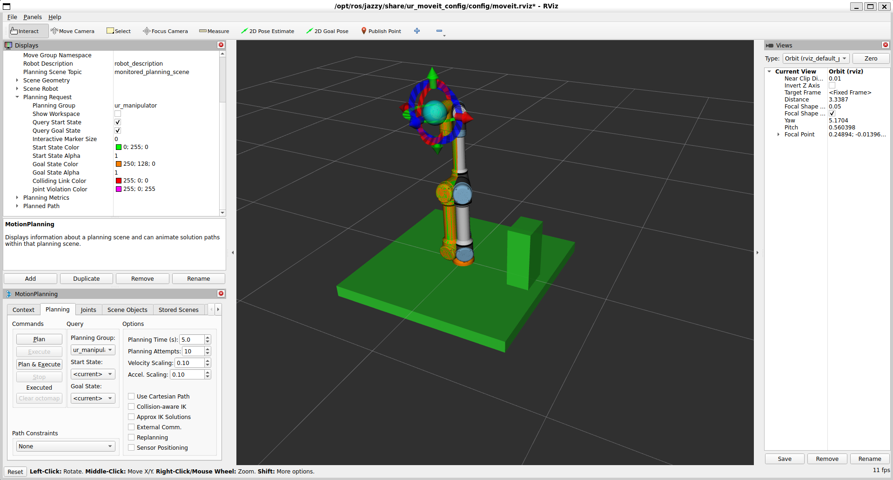

# Simulated Pick & Place Cell

A ROS 2 / MoveIt 2 portfolio project for a simulated UR5e workcell.

## Scene preview



*Current scene in RViz: UR5e with mock hardware, a table, and a box obstacle. Start and goal query overlays are visible. This screenshot documents scene geometry. State collision detection was verified separately using a temporary obstacle; path avoidance has not yet been validated.*

## Current status

**First C++ motion completed; scene geometry added and state collision detection verified.**

- Ubuntu 24.04 in WSL2; ROS 2 Jazzy and MoveIt 2 installed from binary packages.
- UR5e with mock hardware, visualized in RViz.
- Motion planned and executed through RViz.
- Custom C++ package `cell_planner` built with colcon.
- `setup_scene` adds a table and a box obstacle to the MoveIt planning scene; both are visible in RViz.
- `first_motion` reads the current joint state, adds 0.2 rad to `shoulder_pan_joint`, plans and executes the motion.

The first C++ motion was observed in RViz and reported success. Quantitative benchmarks have not been collected yet.

## Architecture

```text
first_motion (C++ / MoveGroupInterface)
  -> move_group (MoveIt 2)
  -> scaled_joint_trajectory_controller (ros2_control)
  -> mock hardware
  -> joint_state_broadcaster -> /joint_states
  -> robot_state_publisher -> TF -> RViz
```

## Dependencies

After configuring the ROS 2 apt repository:

```bash
sudo apt install ros-jazzy-desktop ros-dev-tools \
  ros-jazzy-ur ros-jazzy-moveit ros-jazzy-ros2controlcli
```

## Build

The repository is the workspace root, assumed here to be `~/ros2_ws`. Packages are inside `src/`. Keep the workspace in the Linux filesystem under WSL.

```bash
cd ~/ros2_ws
source /opt/ros/jazzy/setup.bash
CMAKE_BUILD_PARALLEL_LEVEL=2 colcon build \
  --packages-select cell_planner --executor sequential
```

## Run

Terminal 1: start mock hardware with the controller used by the default UR MoveIt configuration.

```bash
source /opt/ros/jazzy/setup.bash
ros2 launch ur_robot_driver ur_control.launch.py \
  ur_type:=ur5e robot_ip:=192.0.2.1 \
  use_mock_hardware:=true \
  initial_joint_controller:=scaled_joint_trajectory_controller \
  launch_rviz:=false
```

The required IP argument does not connect to a physical robot in mock mode.

Terminal 2:

```bash
source /opt/ros/jazzy/setup.bash
ros2 launch ur_moveit_config ur_moveit.launch.py \
  ur_type:=ur5e launch_rviz:=true
```

Terminal 3:

```bash
source /opt/ros/jazzy/setup.bash
source ~/ros2_ws/install/setup.bash
ros2 control list_controllers
ros2 run cell_planner first_motion
```

The scaled trajectory controller and joint state broadcaster must be active. Do not send concurrent commands from RViz and the application. Every invocation adds another 0.2 rad to the current shoulder-pan position. Velocity and acceleration scaling factors are 0.1. Target bounds, planning and execution results are checked.

## Load scene geometry

With the robot and MoveIt running, use a terminal sourced as described above:

```bash
ros2 run cell_planner setup_scene
```

This adds or replaces objects named `table` and `obstacle` in the current MoveIt scene. Run it again after restarting MoveIt. Geometry uses the `world` frame and meters. The table measures 1.20 x 1.20 x 0.08 m, centered at (0, 0, -0.06); the obstacle measures 0.15 x 0.20 x 0.40 m, centered at (0.45, 0, 0.18). Box positions refer to their centers.

## Troubleshooting

- Controller mismatch: MoveIt selected the scaled controller while only the ordinary trajectory controller was active. The launch command above explicitly selects the matching controller.
- Start state mismatch: select the current start state and replan in RViz. The C++ program uses the same state snapshot to calculate the target and set the plan start.
- Loop overruns: the default 500 Hz loop produced timing warnings under WSL. For quieter mock-mode debugging, use `ros2 param set /controller_manager overruns.print_warnings false`. This hides these messages; it does not fix timing or change the rate. A lower mock-mode rate remains to be configured and evaluated.
- API variation: the installed `MoveGroupInterface::Plan` exposes `trajectory`, without a trailing underscore.

## Collision detection validation

With the robot, MoveIt, and table scene running:

```bash
source /opt/ros/jazzy/setup.bash
python3 scripts/collision_probe.py
```

The probe captures a joint-state snapshot, computes the `tool0` position using forward kinematics, and adds a temporary 0.30 m box centered at that position. It checks the same robot state before insertion, with the obstacle, and after removal. It sends no motion command. Avoid concurrent robot commands or scene changes during this test.

Observed result from one manual run:

```text
BASELINE valid=True
WITH PROBE valid=False
  forearm_link <-> collision_probe
  wrist_1_link <-> collision_probe
  wrist_2_link <-> collision_probe
  wrist_3_link <-> collision_probe
PASS: MoveIt detected the temporary obstacle.
Temporary obstacle removed.
RESTORED valid=True
```

This confirms detection of robot-environment collisions for the tested configuration and successful restoration of state validity after removal. It does not yet demonstrate path avoidance, continuous collision checking, or physical contact simulation.

## Roadmap

- [x] First C++ motion with UR5e mock hardware.
- [x] Add and visualize a table and one box obstacle.
- [x] Verify state collision detection with a temporary obstacle and restore the original scene.
- [ ] Validate planned paths around an obstacle; add the target bin.
- [ ] Reachability sampling and CSV export.
- [ ] Heatmap and planning comparisons.
- [ ] Object detection and vision evaluation.
- [ ] Simulated pick-and-place sequence.
- [ ] MQTT status and commands; interface documentation.
- [ ] Cycle metrics and demo video.

## Limitations

No physical robot has been used. Mock hardware provides joint-state feedback without validating contact dynamics or grasp forces. Gazebo, vision, grasp attachment, MQTT and reachability evaluation are not yet implemented. Successful mock execution does not establish real-world accuracy or safety certification.

## Visual documentation

Store images in `docs/images/` and use relative Markdown links so previews work on GitHub.

- `planning-scene.png`: current scene overview, displayed near the top of this README.
- Future: a collision-test screenshot beside the validation results, after the test is completed.
- Future: `reachability-heatmap.png` beside measured reachability results.
- Future: a demo GIF or video link near the top after the integrated workflow works.

Only add image links once the corresponding files exist. Keep terminal logs as text; use screenshots for geometry, trajectories, and plots.

## References

- [ROS 2 Jazzy installation](https://docs.ros.org/en/jazzy/Installation/Ubuntu-Install-Debs.html)
- [UR ROS 2 Driver, Jazzy](https://github.com/UniversalRobots/Universal_Robots_ROS2_Driver/tree/jazzy)
- [MoveIt C++ introduction](https://moveit.picknik.ai/main/doc/tutorials/your_first_project/your_first_project.html)


